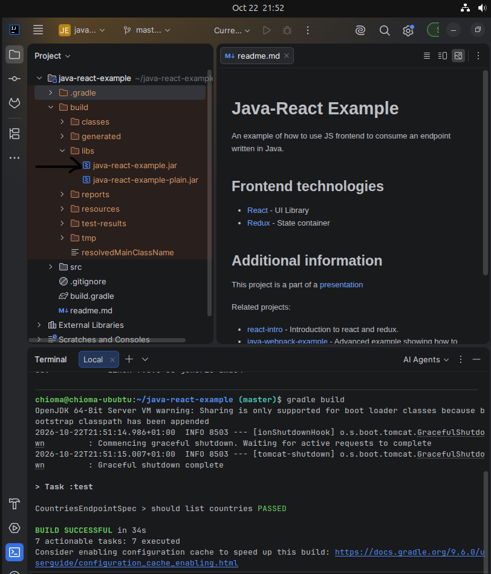
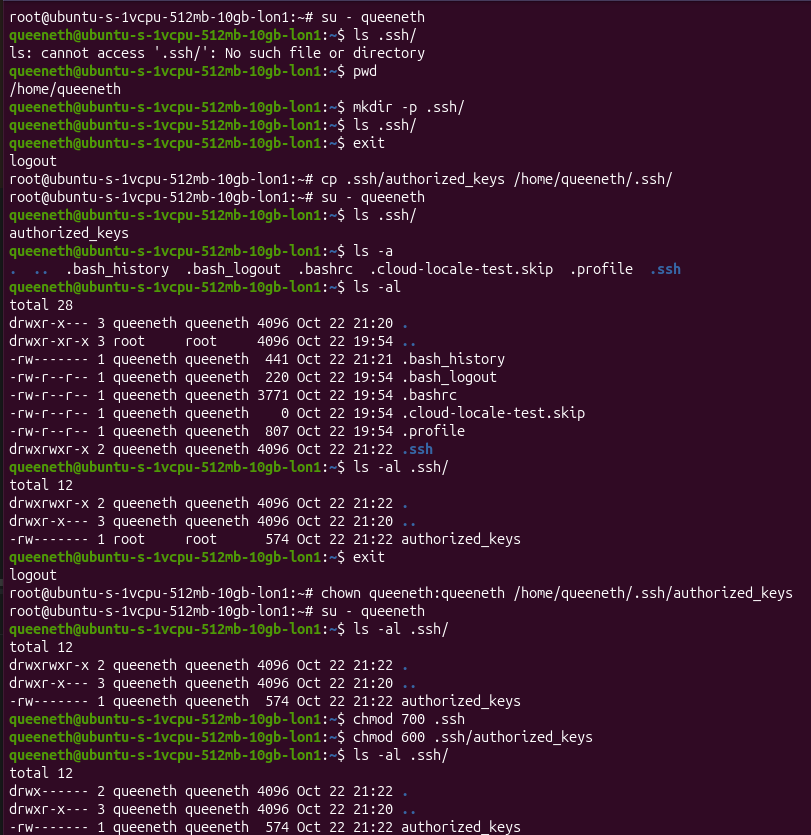
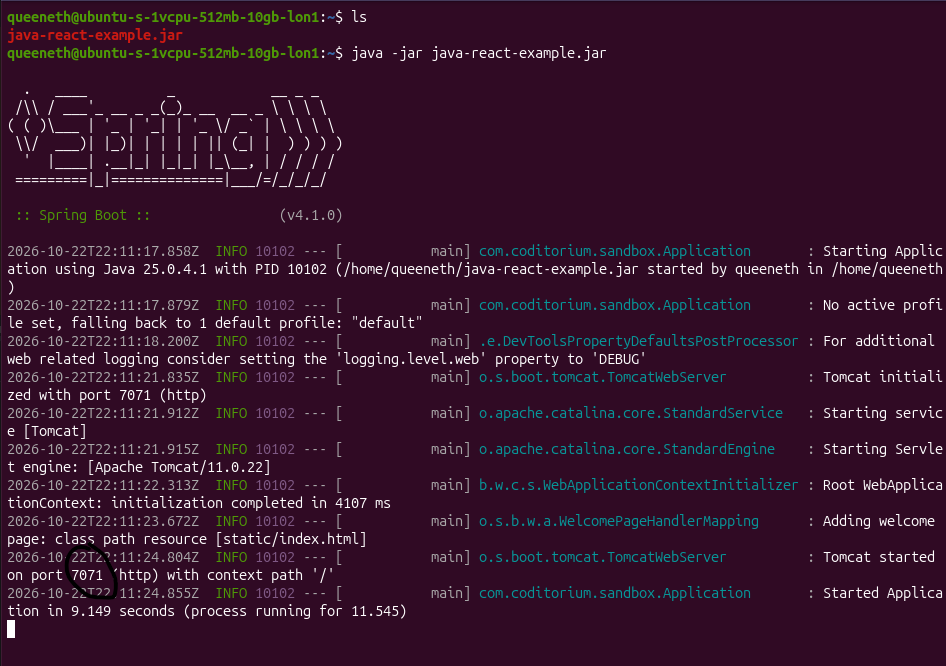
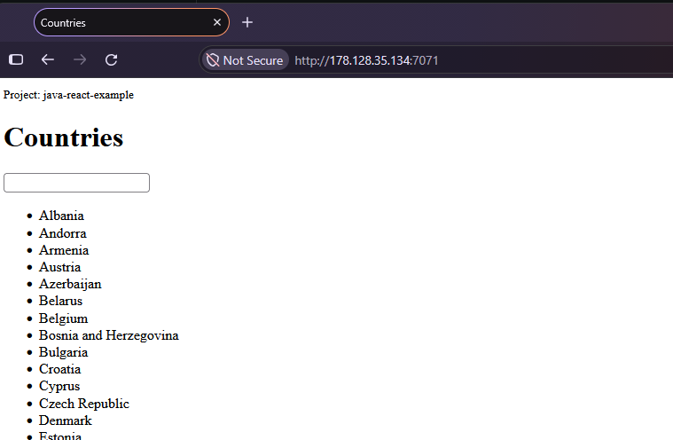

# Cloud Infrastructure & Java Application Deployment

Provisioning, configuring, and deploying a Java application on a Linux-based cloud server using DigitalOcean.

## Overview

This project demonstrates the fundamentals of Infrastructure as a Service (IaaS), focusing on cloud server provisioning, Linux system administration, secure remote access, and application deployment.

The objective was to establish a functional cloud environment capable of hosting and running a Java application built with Gradle.

The implementation covered the full deployment lifecycle: building the application locally, provisioning an Ubuntu server, configuring SSH authentication and Linux user permissions, transferring the application artifact, starting the application, and verifying external accessibility.

## Tech Stack

| Technology | Purpose |
|---|---|
| DigitalOcean | Cloud infrastructure and virtual server hosting |
| Ubuntu 24.04 LTS | Server operating system |
| SSH | Secure remote server access and public-key authentication |
| SCP | Secure application artifact transfer |
| Java 25 JRE | Application runtime |
| Gradle | Application build automation |
| Spring Boot / Embedded Tomcat | Java application framework and web server |
| DigitalOcean Cloud Firewall | Inbound network access control |
| IntelliJ IDEA | Local development and application build environment |

## Implementation Scope

- Provisioned and configured an Ubuntu Droplet on DigitalOcean.
- Generated an SSH key pair and configured key-based authentication.
- Created and configured a dedicated Linux user for application operations.
- Configured SSH authorised keys, file ownership, and permissions.
- Installed the Java runtime on the cloud server.
- Built and packaged a Java application using Gradle.
- Transferred the application artifact using SCP.
- Deployed and executed the application using `java -jar`.
- Configured cloud firewall rules to allow application traffic.
- Verified successful deployment through application startup logs and browser access.

## Deployment Workflow

```text
Java Application Source
          |
          v
Local Gradle Build (IntelliJ IDEA)
          |
          v
Executable JAR Artifact
          |
          v
SCP Transfer
          |
          v
DigitalOcean Ubuntu Droplet
          |
          v
Java Runtime / Spring Boot
          |
          v
Application Listening on Port 7071
          |
          v
Browser Verification
```

The Ubuntu server was provisioned and configured with SSH access, a dedicated Linux user, and the required Java runtime before application execution.

---

## Implementation Walkthrough

### 1. Clone and Build the Java Application

The Java-React example application was cloned from its existing Git repository into IntelliJ IDEA.

Gradle was already installed locally and was used to build the application and generate the deployable JAR artifact.

```bash
gradle build
```

The build completed successfully, generating the application artifact in the `build/libs/` directory.

**IMAGE 1 — LOCAL GRADLE BUILD**

**Screenshot to use:** Page 1 of `Dev Proj Nptes.docx`, the **lower IntelliJ screenshot** showing the Gradle terminal with `BUILD SUCCESSFUL` and the generated JAR visible in the project explorer.

**Save as:** `evidence/01-gradle-build.png`



**Outcome:** The application was successfully built and packaged into a deployable Java artifact.

### 2. Provision the DigitalOcean Droplet

An Ubuntu 24.04 LTS Droplet was created on DigitalOcean using the Basic shared-CPU configuration.

The selected server configuration was:

| Resource | Configuration |
|---|---|
| Cloud provider | DigitalOcean |
| Operating system | Ubuntu 24.04 LTS |
| CPU | 1 vCPU |
| Memory | 512 MB RAM |
| Storage | 10 GB SSD |
| Authentication | SSH public-key authentication |

Before completing Droplet creation, an SSH key pair was generated locally.

Existing SSH keys were checked before creating the new key pair.

```bash
ls -la ~/.ssh
ssh-keygen -t rsa
```

The public key was retrieved from the generated `.pub` file and registered with DigitalOcean to enable key-based SSH authentication.

A cloud firewall was also configured, initially permitting SSH traffic over TCP port `22`.

**Outcome:** An Ubuntu cloud server was provisioned with SSH key-based remote access.

### 3. Create and Configure a Dedicated Linux User

After connecting to the Droplet, a separate Linux user was created for application-related operations rather than routinely using the root account.

The new user's SSH authentication was configured by:

1. Creating the `.ssh` directory inside the user's home directory.
2. Copying the authorised public keys from the root account.
3. Updating the ownership of the SSH configuration files.
4. Applying restrictive permissions to the `.ssh` directory and `authorized_keys` file.

The relevant permissions were:

```bash
chmod 700 ~/.ssh
chmod 600 ~/.ssh/authorized_keys
```

These permissions ensure that SSH authentication files are not unnecessarily accessible to other users. The files must also be owned by the appropriate Linux account.

**IMAGE 2 — LINUX USER AND SSH CONFIGURATION**

**Screenshot to use:** Page 2 of `Dev Proj Nptes.docx`, the **large lower terminal screenshot** showing the new user's `.ssh` directory, `authorized_keys`, `chown`, `chmod 700`, `chmod 600`, and `ls -al` verification.

**Save as:** `evidence/02-linux-user-ssh.png`



**Outcome:** A dedicated Linux account was configured with SSH authentication and appropriate filesystem permissions.

### 4. Install the Java Runtime

The Ubuntu server required a Java runtime to execute the compiled application artifact.

Java was installed using the Ubuntu package manager:

```bash
apt install openjdk-25-jre-headless
```

During the installation, an initial attempt from the dedicated Linux user account encountered a permissions issue because the account did not have sudo privileges.

The installation was subsequently completed using the root account.

**Outcome:** The required Java runtime was installed on the Droplet.

### 5. Transfer the Application Artifact to the Server

Once the Java application was built locally and the server environment was ready, the generated JAR artifact was transferred to the Droplet using SCP.

The transfer followed this command structure:

```bash
scp build/libs/<artifact-name>.jar username@server-ip:/home/username/
```

The file was transferred into the dedicated Linux user's home directory.

The successful transfer was confirmed before executing the application.

**Outcome:** The deployable Java artifact was successfully transferred from the local development environment to the remote Ubuntu server.

### 6. Start the Java Application

The application was started on the Droplet using the Java runtime:

```bash
java -jar <artifact-name>.jar
```

The Spring Boot startup logs confirmed successful application initialisation.

The embedded Tomcat server started and listened for HTTP requests on port `7071`.

**IMAGE 3 — SPRING BOOT APPLICATION STARTUP**

**Screenshot to use:** Page 3 of `Dev Proj Nptes.docx`, the **large lower terminal screenshot** showing the `java -jar` command, Spring Boot banner, application startup logs, and Tomcat listening on port `7071`.

**Save as:** `evidence/03-application-startup.png`



**Outcome:** The Java application was successfully executed on the remote Linux server.

### 7. Configure Firewall Access and Verify Deployment

Although the application was running on the Droplet, external connectivity required the application's listening port to be permitted through the cloud firewall.

A DigitalOcean inbound firewall rule was configured to allow TCP traffic on port `7071`.

The application was then accessed through a web browser using the Droplet's public IP address and application port.

The Countries application loaded successfully, demonstrating that the Java runtime, application process, server networking, and firewall configuration were functioning together.

**IMAGE 4 — APPLICATION ACCESSIBLE IN BROWSER**

**Screenshot to use:** Page 4 of `Dev Proj Nptes.docx`, the **browser screenshot** displaying the running Countries application and its country list.

**Save as:** `evidence/04-browser-verification.png`



**Outcome:** The deployed application was accessible externally through the DigitalOcean Droplet.

**Note:** HTTP was used for this learning exercise. HTTPS configuration and production hardening were outside the scope of the initial deployment.

---

## Troubleshooting & Lessons Learned

### 1. Linux User Privileges and Sudo Access

**Issue:** An attempt to install Java from the newly created Linux user account failed because the account lacked administrative privileges.

**Cause:** Newly created Linux users are not automatically members of the `sudo` group.

**Resolution:** Java installation was completed using the root account.

**Key learning:** Linux users should be granted privileges based on the operations they need to perform.

On Ubuntu, an administrator can add a user to the sudo group using:

```bash
sudo usermod -aG sudo username
```

However, application users do not necessarily require sudo privileges to execute Java applications. Separating system administration from application execution supports the principle of least privilege.

### 2. SSH Authentication and File Permissions

**Challenge:** Creating a Linux user alone was not sufficient to configure SSH public-key authentication for that account.

**Resolution:** Created the user's `.ssh` directory, copied the authorised public keys, corrected ownership, and applied appropriate directory and file permissions.

**Key learning:** SSH public-key authentication depends on the authorised public keys being available to the intended user and on secure ownership and permissions.

Typical permissions include:

```bash
chmod 700 ~/.ssh
chmod 600 ~/.ssh/authorized_keys
```

A separate SSH key pair is not necessarily required for every Linux user.

### 3. Application Port and Cloud Firewall Configuration

**Challenge:** Starting the application on the server did not automatically make it accessible externally.

**Resolution:** Configured the DigitalOcean firewall to allow inbound TCP traffic on port `7071`.

**Key learning:** Application availability depends on both the application listening on the expected interface and port, and the network controls permitting the required traffic.

### 4. Understanding the Build and Deployment Lifecycle

**Key learning:** Building an application and deploying it are separate stages.

- **Gradle** compiled and packaged the application into a JAR artifact.
- **SCP** transferred the artifact from the local machine to the cloud server.
- **Java** executed the packaged application on the Droplet.
- **Spring Boot / Tomcat** served the application over HTTP.
- **DigitalOcean firewall rules** controlled external network access.

This demonstrated how a DevOps workflow can deploy existing application source code without requiring changes to the application itself.

---

## Technical Focus

### Cloud Infrastructure
- Virtual server provisioning and configuration
- Cloud firewall rules and application connectivity
- Infrastructure as a Service fundamentals

### Linux Administration
- SSH key-based authentication
- Linux user and group management
- File ownership and permissions
- Administrative privilege separation

### Application Deployment
- Gradle build and packaging
- JAR artifact transfer using SCP
- Java runtime installation
- Application startup and verification
- Troubleshooting deployment issues

## Project Status

**Completed — Initial Deployment**

The Java application was successfully built, transferred, executed, and verified on a DigitalOcean Ubuntu Droplet.

Potential future enhancements include deployment scripting, systemd service management, HTTPS, and automated application delivery.

## Project Context

Independent hands-on implementation of cloud infrastructure and application deployment fundamentals, undertaken as part of structured DevOps engineering training.

**Original application source:** [Java-React Example — Original Repository](PASTE-ORIGINAL-GITHUB-REPOSITORY-URL-HERE)

The original application was used as the deployment workload. The work documented in this repository focuses on cloud infrastructure configuration, Linux administration, application deployment, verification, and troubleshooting.
